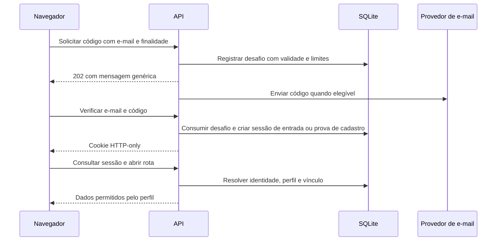

# Design

**Spec**: `.specs/features/autenticacao-email-perfis/spec.md`
**Status**: Draft

## Architecture Overview

O servidor gera um código de oito dígitos e envia o código pelo provedor de e-mail existente. A validação consome o desafio e entrega uma sessão opaca revogável. O perfil e os vínculos são consultados no servidor. O front-end carrega a sessão antes de resolver a rota. Em produção, um proxy de mesma origem encaminha as chamadas ao back-end para que o cookie não dependa do suporte a cookies de terceiros. O CRA usa um proxy equivalente em desenvolvimento.

## Code Reuse Analysis

| Componente | Uso |
| --- | --- |
| EmailSender e ResendEmailSender | Envio do código pelo provedor já configurado. O teste usa um provedor capturador local. |
| TutorService e VeterinarioService | Cadastros e validações existentes, com vínculo da identidade ao registro de domínio. |
| ConsultaRepository, PetRepository e HistoricoAtendimentoRepository | Consultas com filtro de titularidade ou vínculo profissional. |
| Axios, Navbar e módulos de tutor e clínica | Transporte de sessão e reaproveitamento dos painéis existentes. |

## Components

- AuthController e AuthService. Solicitação, verificação, consulta da sessão e saída. A prova de cadastro tem finalidade própria e só permite concluir o cadastro de tutor.
- Camada de segurança da API. Carrega a identidade do cookie, protege mutações contra CSRF, restringe as rotas por método e perfil e nega rotas sem política explícita. Consultas de domínio restringem os IDs ao usuário vigente.
- Cadastro de equipe. Segrega o admin inicial configurado dos perfis operacionais cadastráveis. Vincula o e-mail do veterinário a um registro existente ou criado no mesmo fluxo.
- Painéis e roteamento React. Rotas com prefixo de perfil e lista de links derivada das permissões. Usa fragmento de URL para compatibilidade com hospedagem estática e acesso direto sem regras de reescrita do S3.
- Fluxo público de tutor. Verifica o e-mail antes de enviar nome, CPF, telefone e pets. Usa o cadastro composto já transacional e abre a sessão após concluir.

## Data Models

| Modelo | Campos principais |
| --- | --- |
| Conta | E-mail normalizado único, nome, perfil, estado ativo e vínculo opcional único a tutor ou veterinário. |
| Desafio | E-mail e finalidade, resumo autenticado do código, validade, tentativas, criação e consumo. |
| Sessão | Resumo do token aleatório, conta, validade e revogação. |
| Prova de cadastro | Resumo do token aleatório, e-mail verificado, validade, finalidade e consumo. |

A migração Flyway preserva registros anteriores. Tutores com e-mail normalizado inequívoco são associados à conta. Veterinários existentes aguardam associação por Admin.

## Error Handling Strategy

| Cenário | Resposta |
| --- | --- |
| Código expirado, consumido ou inválido | Erro genérico na verificação e opção de pedir outro código. |
| Solicitação desconhecida ou envio pendente | 202 genérico sem revelar existência de conta. |
| Limite atingido | A solicitação respeita os limites de envio e a verificação rejeita novas tentativas do desafio. |
| Perfil ou recurso proibido | 403 para sessão válida e 401 para sessão ausente ou inválida. |
| E-mail conflitante | 409 no provisionamento administrativo, sem alterar a conta existente. |

## Risks & Concerns

| Risco | Mitigação |
| --- | --- |
| Código curto sujeito a tentativas automatizadas | Geração criptográfica, armazenamento com HMAC, validade curta, contadores e consumo atômico. |
| Implantações atuais usam origens distintas | Documentar o proxy de API em mesma origem e cookies seguros em HTTPS. |
| Consultas do tutor usam dados globais e fallback de demonstração | Substituir dados de exemplo e URLs fixas por requisições autenticadas e consultas por identidade. |
| API aceita operações sem perfil | Política fechada por padrão e testes HTTP de permissões e titularidade. |
| Credenciais podem vazar nos logs | Provedor configurado, sem log de código, cookie ou prova. |

## Tech Decisions

| Decisão | Escolha | Racional |
| --- | --- | --- |
| Sessão | Token opaco aleatório em cookie HTTP-only, com digest persistido. | Permite revogação imediata e consulta do perfil atual. Um JWT precisaria de consulta adicional para a mesma revogação e vínculo. |
| Expiração | Dez minutos para o desafio e até oito horas para a sessão. | Comportamento registrado na especificação aprovada. |
| Autorização | Regras por método e caminho e validação do recurso no domínio. | Evita que alterar IDs ou acionar a API diretamente amplie o acesso. |
